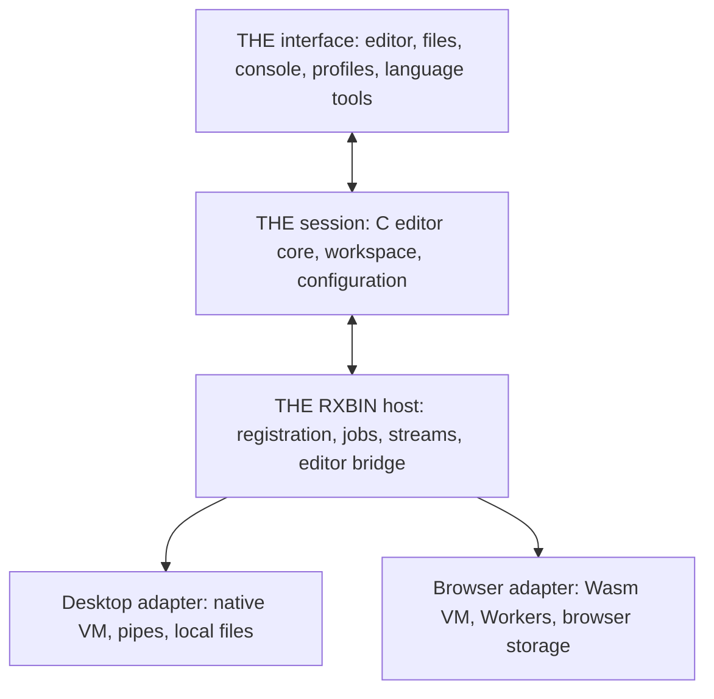

# THE Architecture Overview

THE is a procedural C editor descended from XEDIT/KEDIT. This fork keeps the
classic command, file-ring, view, and Rexx macro model, but the UI architecture
now separates editor state from physical terminal mechanics.

## Common desktop and browser application

Desktop and browser are execution hosts for one THE application. Desktop uses
the native editor/VM and local files; browser uses the Wasm editor/VM, Workers
and browser storage. Graphical desktop and browser share the workbench UI;
the terminal driver presents the same editor, console and tool operations.



THE owns editor state, source identities/revisions, tool registration, job and
console state, workspace policy, profile selection and result admission. UI
drivers translate physical input and render that state. They do not own VM
instances, decide what source to run or independently clear a job's state.
cREXX owns the VM, compilers/interpreters and portable runtime providers.
DSLSH owns its language-service model, protocols and adapters. Implementation
and qualification of this common model follow the stages in the [roadmap](roadmap.md).

### RXBIN roles and sessions

RXBIN is the common executable unit. A tool registration names an image, its
entry protocol, compatible runtime/dependencies, language associations and
required host capabilities. Source execution delegates to a registered language
runner. Compiler and assembler host helpers can implement a registered build
operation; a native compiler is not relabelled as RXBIN bytecode.

| Role | Lifetime and authority |
| --- | --- |
| Program / language runner | One job per invocation, separate stdin/stdout/stderr and completion, explicit Stop. Source runs use the entire C-owned buffer including its pending record. |
| Profile / macro | Session integration through ADDRESS THE, EXTRACT and READ. Editor commands execute on the editor owner. Compile/validation precedes activation. |
| Language service | Persistent service sessions with document identities/revisions, styles and diagnostics; independently restartable. Results are admitted by the editor owner. |

These roles share discovery, lifecycle and error reporting, not one VM or one
stdio protocol. Profile callbacks can require the editor's synchronous execution
owner, including nested READ. Programs and parsers run independently. Incoming
messages queue work; they never reenter a running/suspended editor C stack.

### Console and workspace

The console is a THE session model: selected job, bounded output, input, EOF,
state and completion/error information. A terminal split and a graphical split
are projections of that model. The editor command line remains distinct from
program stdin. Language-service control frames never become visible program
output. A waiting-input or completed state publishes all preceding output.
Stopping an isolated job preserves editor buffers, views and parser sessions;
hard termination is distinct from graceful Rexx completion/cleanup.

Workspace files, editable profiles and tool registrations use logical workspace
identities. Host adapters implement persistence and explicit import/export.
Saving acknowledges the backend's successful commit before clearing dirty state.
Run neither saves nor alters the source buffer. A running job retains its source
identity/revision even when that buffer changes or closes.

### Profile and language-tool workflow

The common profile workflow is **Edit → Build/Validate → Activate**. Source is
authoritative and compiled images are versioned cache artifacts. Build failure
retains the last working selection and does not execute partially compiled code.
Activation errors remain visible; arbitrary editor commands cannot be promised
transactional rollback. Persisted selection identifies the validated artifact
and its runtime compatibility, so startup does not silently use a stale cache.

Adding a language service associates a registered RXBIN with a language/file
type and a supported service protocol. THE manages its lifecycle and accepts
only results for the current document revision. Built-in/default registrations
and user additions use the same interface. Capabilities are explicit: native
filesystem/process facilities are not implied by a browser VM, and a native
child process alone is not an operating-system sandbox.

For the detailed cursor/driver contract, read
`doc/cursor-driver-architecture.md`. For UTF behavior, read [terminal profiles](utf-design.md).
Current limitations and plans are in [known issues](known-issues.md) and
the [roadmap](roadmap.md).

## Supported Platforms

The maintained platform targets are:

- macOS.
- Linux/POSIX.
- native Windows.

Historical DOS, OS/2, VMS, Amiga, BeOS, QNX, DJGPP/GO32, and ancient compiler
source branches have been retired. Some command names and help text still use
historical names such as `DOS` because they are editor command compatibility
surface, not supported platform declarations.

## Runtime Shape

The main executable is `the`. It owns command-line parsing, editor startup,
file/profile setup, command dispatch, macro integration, and driver module
selection. It does not link curses directly.

Drivers are runtime-loaded modules:

- `the_driver_curses`: the default terminal UI. It owns curses startup/shutdown,
  windows, physical cursor mechanics, refresh ordering, raw terminal input,
  mouse packet decoding, terminal palette allocation, and software cursor
  painting.
- `the_driver_llm`: the no-curses LLM UI. It boots the real editor runtime and
  exposes semantic snapshots and normalized input over stdin/stdout through
  `the --driver llm`.
- `the_driver_web`: an optional browser frontend, reusing headless surfaces and
  semantic snapshots with a local HTTP/WebSocket transport and restricted
  workspace/command policy.

All drivers implement the neutral `TheDriverOps` surface from
`src/thedriver.h`. Public driver types are curses-free.

## Core Editor Model

The editor core manages:

- `LINE`: file text in doubly-linked lists.
- `FILE_DETAILS`: loaded file metadata and file-ring state.
- `VIEW_DETAILS`: per-view display, cursor, selection, prefix, and screen state.
- command tables in `src/command.h` and command implementations in
  `src/comm*.c`, `src/execute.c`, and related modules.
- Rexx/CREXX profile and macro execution through `src/rexx.c` and
  `src/crexx.c`.

Core editor code owns logical state: file lines, logical cursor positions,
row roles, prefix and command-line text, block/selection state, syntax/style
categories, logical colors, and logical key identity. It must not infer editor
state from physical curses cursor or window state.

## Working records and text commits

`rec` / `rec_len` are the active edit record; `LINE` owns the buffer's stored
in-memory text. `pre_process_line` loads a record from its line.
`post_process_line` commits changes, increments alteration counters, retains
recovery text and synchronizes the parser. Editing commands must commit before
cursor movement or presentation can reload that record. `src/commsos.c` follows
this order for character deletion and erase-to-end. SAVE then writes the
buffer's committed lines through the normal file path.

UI modules use logical cursor state and shared frames. A refresh is not a text
mutation or save operation. The loader checks the exported driver-module ABI;
keep the executable and its modules from a matching build together.

## Logical UI And Rendering

Several modules provide the driver-neutral view of the editor:

- `src/textpos.c`, `src/logcursor.c`, `src/utflayout.c`, `src/utfrepair.c`,
  and `src/utfterm.c` model logical UTF positions and terminal repair policy.
- `src/uidriver.c` and `src/screenframe.c` build logical row-role snapshots.
- `src/rendercell.c` models UTF render cells and clusters independently of
  curses `chtype` / `cchar_t`.
- `src/transientui.c` models readv/dialog/popup state without terminal APIs.
- `src/inputevent.c` models normalized text, key, command, logical-hit, and
  debug input events.

The curses driver lowers this logical model to a terminal. The LLM driver
formats the same logical model as structured text for agents.

## LLM Driver

`the --driver llm` is the strategic no-curses agent/editor surface. It uses the
real THE runtime: real buffers, views, command dispatch, profiles, syntax
state, parser diagnostics, file-ring state, block state, and CREXX integration
when available.

Supported protocol verbs include `look`, `delta`, `capabilities`, `focus`,
`hit`, `key`, `text`, `type`, `insert`, `command`, `debug`, `transient`, and
`quit`.

Capability details live in `doc/llm-driver-capabilities.md`; agent usage
guidance lives in `doc/llm-mode.md` and `doc/llm-driver-agent-guide.md`.

## Scripting And Extension

THE remains deeply integrated with Rexx-style scripting. CREXX support is
build-dependent and uses `crexxsaa` to compile/cache source profiles and
macros, run `.rxbin` macros, and register `ADDRESS THE` as a native callback
environment. CREXX scripts issue normal THE commands through the existing
command subsystem.

See `doc/crexx.md` for the current bridge contract.

## Testing And Guardrails

Key guardrails:

- `the` and `the_driver_llm.so` must not link curses.
- `src/the.h` and `src/thedriver.h` must remain curses-free.
- raw curses input, paint, window, cursor, and cell mechanics must stay in
  `src/drivers/curses/**` or explicit physical driver operations.
- real editor behavior for agents should be tested through `the --driver llm`,
  not through a fake editor harness.

Useful verification:

```sh
git diff --check
bash tests/inventory_direct_curses.sh --summary "$PWD"
ctest --test-dir cmake-build-debug \
  -R 'test_driver_modules|test_the_llm_full_runtime|test_curses_boundary|test_curses_boundary_inventory' \
  --output-on-failure
```

The maintained [test guide](testing.md) maps contracts to checks and explains
source, installed, native input and visual qualification.
